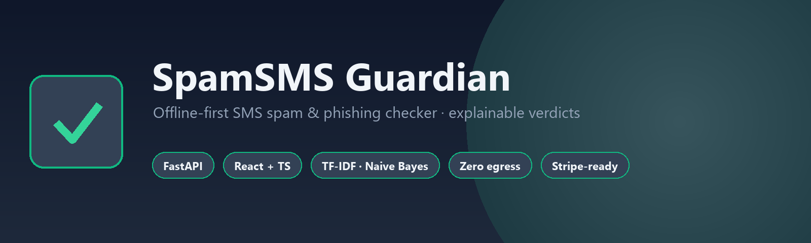

<p align="center">
  
</p>

<h1 align="center">🛡️ SpamSMS Guardian</h1>

<p align="center">
  <b>An offline-first SMS spam &amp; phishing checker with a real web UI, explainable verdicts, and optional Stripe billing.</b><br/>
  Paste a suspicious text → get an honest verdict (<b>spam / safe / unsure</b>) with the exact clues that drove it.<br/>
  Bulk-scan a CSV inbox export on Pro. Analyzed locally by <i>your</i> server — never forwarded to a third party.
</p>

<p align="center">
  <a href="LICENSE"></a>
  
  
  
  
  
</p>

<p align="center"><b>▶ <a href="https://mehtadeven.github.io/spam-sms-checker/">Try the live demo</a></b> — the real UI with the trained model running in your browser.</p>

---

## ✨ Features

- **Real website, not a notebook** — Vite + React + TypeScript + Tailwind frontend talking to a typed FastAPI backend.
- **Explainable ML** — TF-IDF + Multinomial Naive Bayes, with per-verdict "learned clues" surfaced in the UI.
- **Honest uncertainty** — a `UNSURE` band instead of a coin-flip. Out-of-vocabulary texts like *"ok"* or *"sure"* are no longer mislabeled as spam (see [Why UNSURE?](#why-a-third-label)).
- **Local threat-signal checks** — flags links, URL shorteners, raw-IP links, secret/OTP requests, urgency, and money language. **No link is ever opened.**
- **Bulk inbox scanning** (Pro) — upload a CSV export, get per-row verdicts + aggregated signal analytics.
- **Accounts + trial + paywall** — anonymous free checks → 14-day trial → Pro, enforced atomically (no double-spend).
- **Stripe-ready billing** — real Checkout + verified webhooks when you add keys; a zero-config **offline mock** drives the whole funnel otherwise.
- **Tested & offline-guaranteed** — pytest suite includes a test that blocks all outbound sockets to prove the offline promise.

---

## 🌐 Live demo

**[mehtadeven.github.io/spam-sms-checker](https://mehtadeven.github.io/spam-sms-checker/)** — the real React UI, built in *static demo* mode (`VITE_STATIC_DEMO=true`). There is no server: [`scripts/export_web_model.py`](scripts/export_web_model.py) exports the trained TF-IDF + Naive Bayes model to `frontend/public/model.json`, and [`frontend/src/lib/localModel.ts`](frontend/src/lib/localModel.ts) reproduces `predict_message()` — verdict, spam estimate, learned clues and threat signals — in the browser. Accounts, inbox scan and billing need the FastAPI backend, so the demo hides them.

[`.github/workflows/pages.yml`](.github/workflows/pages.yml) rebuilds and redeploys the demo on every push to `main`. To build it yourself:

```bash
python scripts/export_web_model.py          # only after changing data/sample.csv or the model
cd frontend
VITE_STATIC_DEMO=true VITE_BASE=/spam-sms-checker/ npm run build
```

## 🚀 Quickstart

Prerequisites: **Python 3.12+** and **Node 18+**.

### 1 · Backend

<details open><summary><b>Git Bash / Linux / macOS</b></summary>

```bash
cd backend
python -m venv .venv && . .venv/Scripts/activate   # Windows Git-Bash
# python -m venv .venv && source .venv/bin/activate # macOS/Linux
pip install -r requirements.txt
python -m uvicorn spamsms.main:app --port 8000
```
</details>

<details><summary><b>PowerShell (Windows)</b></summary>

```powershell
cd backend
python -m venv .venv
Set-ExecutionPolicy -Scope Process RemoteSigned   # allow Activate.ps1 on stock Windows
.\.venv\Scripts\Activate.ps1
pip install -r requirements.txt
python -m uvicorn spamsms.main:app --port 8000
```
</details>

The app self-trains a starter model from `data/sample.csv` on first launch. No API key needed.

### 2 · Frontend (dev, hot reload)

```bash
cd frontend
npm install
npm run dev          # http://localhost:5173  (proxies /api → :8000)
```

### 3 · Production build served by one process

```bash
cd frontend && npm run build      # emits frontend/dist
cd ../backend && python -m uvicorn spamsms.main:app --port 8000
# open http://localhost:8000  — FastAPI serves the built SPA same-origin
```

### 4 · Make it yours (settings)

Everything runs with **zero configuration**. To customize quotas, the database
location, CORS, or billing, copy the example env file and edit it — every option
is documented in [⚙️ Settings](#-settings--configuration):

```bash
cp .env.example backend/.env      # then open backend/.env in an editor
```

> Prefer shortcuts? The [`Makefile`](Makefile) wraps the common commands:
> `make install-backend`, `make dev`, `make build`, `make test`, `make serve`.

---

## 🔌 API

| Method | Path | Auth | Description |
|---|---|---|---|
| `POST` | `/api/analyze` | quota (anon/trial/paid) | Classify one message |
| `POST` | `/api/scan` | **Pro** | Bulk-scan a raw-body CSV |
| `POST` | `/api/auth/register` · `/login` · `/logout` | — | Bearer-token accounts |
| `GET` | `/api/auth/me` | token | Current user + plan |
| `POST` | `/api/billing/checkout` | token | Create Stripe/mock checkout |
| `POST` | `/api/billing/webhook` | Stripe sig | Payment events (idempotent) |
| `GET` | `/health` | — | Liveness + active billing provider |

Example:

```bash
curl -X POST http://localhost:8000/api/analyze \
  -H "Content-Type: application/json" \
  -d '{"text":"Congratulations! You won a prize. Claim now at https://bit.ly/x"}'
```

CSV scan sends **raw bytes** (no multipart dependency):

```bash
curl -X POST http://localhost:8000/api/scan \
  -H "Authorization: Bearer <token>" -H "Content-Type: text/csv" \
  --data-binary @inbox.csv
```

---

## 💳 Billing: mock by default, Stripe when you add keys

Out of the box `BILLING_PROVIDER=mock`: the entire upgrade funnel works with **zero keys and zero network**, so reviewers can click through signup → trial → paywall → Pro instantly (the UI labels it *demo mode*).

To enable real payments, set these in `backend/.env`:

```
STRIPE_SECRET_KEY=sk_live_xxx
STRIPE_WEBHOOK_SECRET=whsec_xxx
STRIPE_PRICE_ID=price_xxx        # a Subscription Price created in the dashboard
FRONTEND_ORIGIN=https://your.app
```

Then point a webhook at `POST /api/billing/webhook`. For local testing with real Stripe:

```bash
stripe listen --forward-to localhost:8000/api/billing/webhook
```

> ⚠️ Accepting live card payments requires **your own Stripe account** and a business entity in a supported country. This repo ships the integration, not the merchant account.

---

## ⚙️ Settings / Configuration

All settings are read from environment variables (or a `.env` file) through
`pydantic-settings`. The file is looked up at **`backend/.env`** or the repo root
`.env`. **Every value is optional** — with no `.env` at all the app runs fully
offline using the defaults below. Copy the template to get started:

```bash
cp .env.example backend/.env
```

| Variable | Default | What it does |
|---|---|---|
| `ENVIRONMENT` | `development` | Free-form label. Set to `prod`/`production` to flip the app into production mode (`is_production`). |
| `DATABASE_PATH` | `%LOCALAPPDATA%/spamsms/spamsms.db` (Win) · `~/.spamsms/spamsms.db` (elsewhere) | Where the SQLite database lives. A path here overrides the OS default. |
| `ANONYMOUS_GRACE_LIMIT` | `10` | Free checks allowed before a visitor must sign up. |
| `TRIAL_DAYS` | `14` | Length of the Pro trial in days. |
| `TRIAL_ANALYSES` | `200` | Max analyses a user may run during the trial. |
| `MAX_SCAN_ROWS` | `10000` | Row cap for a bulk CSV `/api/scan` upload. |
| `MAX_SCAN_BYTES` | `2097152` (2 MiB) | Byte cap on the raw CSV request body. |
| `RATE_LIMIT_PER_MINUTE` | `60` | Token-bucket rate limit per IP + user. |
| `CORS_ORIGINS` | `[]` (same-origin) | JSON list of allowed origins, e.g. `["http://localhost:5173"]`. Leave empty when using the Vite proxy or same-origin hosting. |
| `STRIPE_SECRET_KEY` | *unset* | If set, billing switches from mock to real Stripe Checkout. |
| `STRIPE_WEBHOOK_SECRET` | *unset* | Verifies signatures on `POST /api/billing/webhook`. |
| `STRIPE_PRICE_ID` | *unset* | The Subscription Price id created in the Stripe dashboard. |
| `BILLING_PROVIDER_OVERRIDE` | *unset* | Force `"mock"` or `"stripe"` regardless of keys (dev/testing). |
| `FRONTEND_ORIGIN` | `http://localhost:5173` | Origin used for Stripe success/cancel redirect URLs. |

**Resolution order:** explicit environment variable → `.env` file → built-in
default. Billing provider is chosen automatically: `stripe` if
`STRIPE_SECRET_KEY` is present, otherwise `mock` — unless
`BILLING_PROVIDER_OVERRIDE` forces one. Check which is active any time with
`GET /health`.

### Example `backend/.env`

```dotenv
ENVIRONMENT=production
DATABASE_PATH=/var/lib/spamsms/spamsms.db

ANONYMOUS_GRACE_LIMIT=5
TRIAL_DAYS=14
TRIAL_ANALYSES=200
MAX_SCAN_ROWS=20000
RATE_LIMIT_PER_MINUTE=120
CORS_ORIGINS=["https://app.example.com"]

# Real payments (omit these to stay on the offline mock)
STRIPE_SECRET_KEY=sk_live_xxx
STRIPE_WEBHOOK_SECRET=whsec_xxx
STRIPE_PRICE_ID=price_xxx
FRONTEND_ORIGIN=https://app.example.com
```

---

## 🧠 Architecture

```
Browser ──▶ Vite dev proxy (:5173) ─┐
                                    ├─▶ FastAPI (:8000)
Built SPA served same-origin ───────┘        │
                                             ├─ routers: auth · analyze · scan · billing
                                             ├─ security.py  PBKDF2 + bearer tokens + quota
                                             ├─ billing.py    MockProvider | StripeProvider
                                             ├─ db.py         stdlib sqlite3 (WAL, atomic guards)
                                             └─ model.py      TF-IDF + Naive Bayes (OFFLINE)
```

- **Auth**: opaque bearer tokens (not cookies) — sidesteps the cross-port cookie trap and makes CSRF structurally impossible. Only `sha256(token)` is stored.
- **Persistence**: Python's stdlib `sqlite3`. Trial credits are spent inside a single `UPDATE … WHERE trial_used < limit` under `BEGIN IMMEDIATE`, so concurrent requests cannot double-spend.
- **Network egress**: only `billing.StripeProvider` may touch the network, lazily and only when a key is set. A test patches `socket` to fail the suite if anything else phones home.

## Why a third label?

Naive Bayes returns exactly `0.5` for text matching none of its vocabulary, and a `>= 0.5` rule breaks that tie toward **spam** — so benign replies like *"ok"*, *"sure"*, *"lol"* were flagged as spam. We require matched vocabulary and use a conservative display band (`[0.35, 0.65]`) so uncertain cases say **UNSURE** instead of guessing. The band edges are presentation constants, **not calibrated probabilities**. Binary training metrics in `models/metrics.json` are unchanged; the unsure rate is reported separately.

## ⚖️ Honest limitations

The bundled model trains on a **48-row demo corpus**. Held-out accuracy (~92%) illustrates the pipeline; it is **not a benchmark**. Scammers adapt fast — treat every verdict as guidance, not proof. To improve: drop a larger, appropriately licensed `label,message` CSV at `data/sample.csv` and run `python train_model.py`.

---

## 🧪 Tests

```bash
cd backend && python -m pytest
```

Covers: the UNSURE/tie-break fix, auth, **trial double-spend concurrency**, entitlement gating, the mock→Pro funnel, Stripe webhook signature verification + idempotency, and a full-flow test proving **zero network egress**.

## 📦 Download

Grab the source via **Code ▸ Download ZIP** on GitHub, or clone:

```bash
git clone https://github.com/<you>/spamsms-guardian.git
```

## 🤝 Contributing

Contributions welcome — see [CONTRIBUTING.md](CONTRIBUTING.md). Please keep the offline-first guarantee intact and add tests for new behavior.

## 📄 License

[MIT](LICENSE) © 2026 SpamSMS Guardian contributors.
